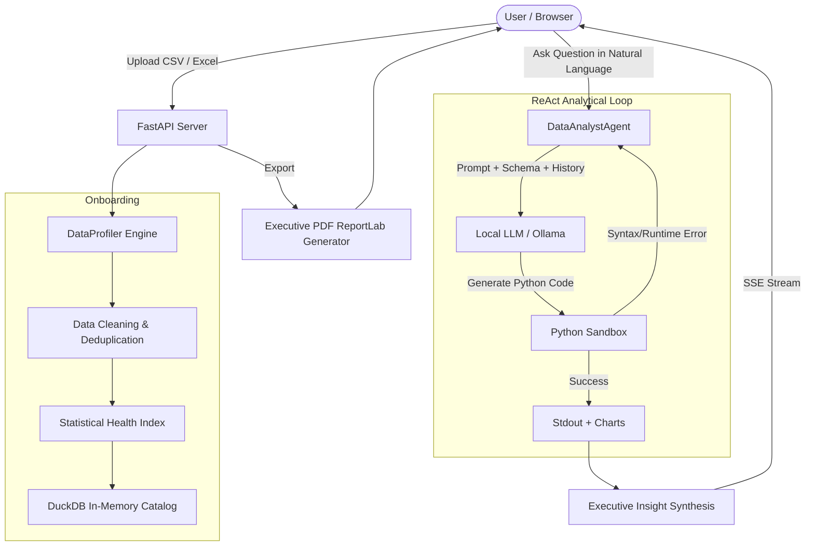

# 🤖 Autonomous Data Analyst Agent

[](https://www.python.org/)
[](https://fastapi.tiangolo.com/)
[](https://duckdb.org/)
[](https://ollama.ai/)
[](LICENSE)

An autonomous, **100% local-first AI data analyst** powered by local LLMs (via [Ollama](https://ollama.ai/)), [DuckDB](https://duckdb.org/), [Pandas](https://pandas.pydata.org/), and [FastAPI](https://fastapi.tiangolo.com/).

Upload single or multi-table datasets (CSV / Excel), receive automated profiling and data health scoring, explore data using natural language, execute code in a self-healing sandbox, generate high-resolution charts, and export executive PDF reports—**without your data ever leaving your machine**.

---

## 🌟 Key Features

- 🔒 **100% Local & Privacy-Preserving**: Runs completely offline using local models via Ollama (`qwen2.5-coder`, `phi3.5`, `llama3.1`, etc.). No API keys or cloud dependencies required.
- 🧹 **Automated Data Onboarding & Cleaning**:
  - Automatically cleans column names (snake_case conversion, whitespace stripping).
  - Identifies and parses date formats.
  - Detects duplicate records and computes a composite **Data Quality Score (0–100)**.
- ⚡ **Dual-Engine Execution (DuckDB + Pandas)**:
  - Supports single datasets and relational multi-table uploads.
  - Discovers relational keys and pre-registers tables in an in-memory DuckDB catalog for lightning-fast SQL queries and joins.
- 🛠️ **ReAct Loop with Self-Healing Execution**:
  - Employs a multi-turn ReAct reasoning loop.
  - Code runs in an isolated Python execution sandbox.
  - Automatically catches runtime exceptions and syntax errors, feeding traceback information back into the LLM for self-correction (up to 3 retries).
- 📈 **Dynamic Chart Generation**:
  - Automatically visualizes trends and distributions using Seaborn and Matplotlib.
  - Thread-safe rendering with `Agg` backend; charts are saved, served, and displayed dynamically in the UI.
- 🌊 **Real-Time Streaming UI (SSE)**:
  - Server-Sent Events (SSE) stream code generation tokens, sandbox logs, and telemetry directly to the frontend.
  - Includes heartbeat keepalives to prevent timeouts during intense local CPU/GPU prompt evaluation.
- 🧠 **Context & Session Memory**:
  - Maintains a rolling history of key analytical findings to answer progressive follow-up questions.
- 📑 **One-Click Executive PDF Reports**:
  - Compiles dataset statistics, cleaning history, analytical Q&A insights, and generated visualizations into a multi-page PDF using ReportLab.

---

## 🏗️ Architecture & Workflow



---

## 📁 Project Structure

```text
Data Analyst Agent/
├── assets/                 # Static assets & dynamic runtime charts
│   └── charts/             # Generated visualization outputs (.gitkeep)
├── core/                   # Core agent engine
│   ├── __init__.py
│   ├── agent.py            # ReAct reasoning loop & query orchestration
│   ├── llm_client.py       # Ollama API client & health check
│   ├── profiler.py         # Data profiling, quality score & cleaning
│   ├── reporter.py         # ReportLab executive PDF generation
│   └── sandbox.py          # Safe execution sandbox with DuckDB/Pandas proxy
├── exports/                # Generated PDF reports (.gitkeep)
├── samples/                # Sample datasets for quick testing
│   └── sample_sales_data.csv
├── static/                 # Frontend Web UI (HTML5, CSS3, Vanilla JS)
│   ├── css/
│   │   └── app.css         # Modern responsive dashboard styling
│   ├── js/
│   │   └── app.js          # SSE handling, chart rendering, interactive state
│   └── index.html          # Main application page
├── .env.example            # Environment configuration template
├── .gitignore              # Git ignore configuration
├── config.py               # Application configuration & path resolution
├── LICENSE                 # MIT License
├── requirements.txt        # Python package dependencies
└── server.py               # FastAPI application & SSE endpoints
```

---

## 🚀 Quick Start

### 1. Prerequisites

- **Python**: Version 3.10 or higher.
- **Ollama**: Installed and running on your system. Download from [ollama.ai](https://ollama.ai/).

### 2. Pull an LLM Model in Ollama

We recommend `qwen2.5-coder:3b` (fast, lightweight, highly accurate at pandas/duckdb code) or `qwen2.5-coder:7b`:

```bash
ollama pull qwen2.5-coder:3b
```

*(Ensure Ollama is running in the background: `ollama serve`)*

### 3. Clone & Set Up the Repository

```bash
# Clone the repository
git clone https://github.com/<your-username>/data-analyst-agent.git
cd data-analyst-agent

# Create a virtual environment
python -m venv .venv

# Activate the virtual environment
# Windows (Command Prompt):
.venv\Scripts\activate.bat
# Windows (PowerShell):
.venv\Scripts\Activate.ps1
# macOS / Linux:
source .venv/bin/activate

# Install required dependencies
pip install -r requirements.txt
```

### 4. Configure Environment

Copy the `.env.example` file to create your `.env` file:

```bash
# Windows
copy .env.example .env

# macOS / Linux
cp .env.example .env
```

Modify `.env` if your Ollama instance runs on a different port or if you wish to use a different model:

```env
OLLAMA_BASE_URL=http://localhost:11434
MODEL_NAME=qwen2.5-coder:3b
```

### 5. Launch the Application

Start the FastAPI server using Uvicorn:

```bash
uvicorn server:app --reload --port 8000
```

Open your browser and navigate to:
```
http://localhost:8000
```

---

## 🧪 Testing with Sample Data

A ready-to-use sample dataset is provided in `samples/sample_sales_data.csv`.

1. Launch the application and open `http://localhost:8000`.
2. Drag and drop `samples/sample_sales_data.csv` onto the upload zone.
3. Observe the automated 5-step onboarding:
   - Ingestion & parsing
   - Automated cleaning
   - Statistical profiling & quality index
   - DuckDB registration
   - Initial executive briefing & suggested hypotheses
4. Try asking questions such as:
   - *"Which product category generates the highest total profit?"*
   - *"Show a bar chart of units sold by region with profit margins."*
   - *"What is the monthly sales trend?"*
5. Click **Export PDF Report** to download an executive summary.

---

## 📡 API Reference

| Endpoint | Method | Description |
| :--- | :---: | :--- |
| `/` | `GET` | Serves the web dashboard interface |
| `/api/status` | `GET` | Checks health of Ollama and active dataset |
| `/api/upload` | `POST` | Ingests CSV or Excel files synchronously |
| `/api/upload-stream` | `POST` | Ingests files with real-time SSE progress events |
| `/api/query` | `POST` | Executes analytical query synchronously |
| `/api/query-stream` | `POST` | Streams code generation, execution, and synthesis via SSE |
| `/api/table/{name}/preview` | `GET` | Returns first 25 records and schema for a table |
| `/api/table/{name}/export` | `GET` | Exports cleaned table as CSV |
| `/api/export-pdf` | `POST` | Compiles and downloads an executive PDF report |
| `/api/chat/clear` | `POST` | Clears conversation history and generated charts |
| `/api/session/reset` | `POST` | Resets all active datasets, tables, and agent memory |

---

## ⚙️ Configuration Options

Configuration is centralized in `config.py` and configurable via `.env`:

| Variable | Default Value | Description |
| :--- | :--- | :--- |
| `OLLAMA_BASE_URL` | `http://localhost:11434` | URL of the local Ollama instance |
| `MODEL_NAME` | `qwen2.5-coder:3b` | Target LLM model name |
| `MAX_RETRIES` | `3` | Maximum self-healing code retry attempts in sandbox |

---

## 🛡️ Security & Sandbox Design

- **Safe Execution**: User queries do not execute directly on host files; data frames are pre-loaded in memory.
- **Thread Safety**: Matplotlib backend configured to `Agg` to ensure non-blocking, headless visual rendering.
- **Local Isolation**: All LLM processing occurs strictly through your local Ollama runtime—ideal for proprietary and sensitive business data.

---

## 📄 License

This project is licensed under the MIT License - see the [LICENSE](LICENSE) file for details.

